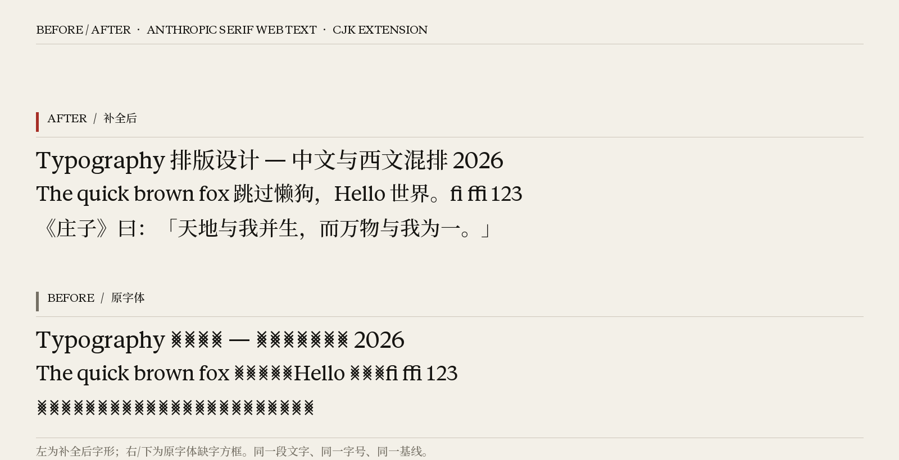
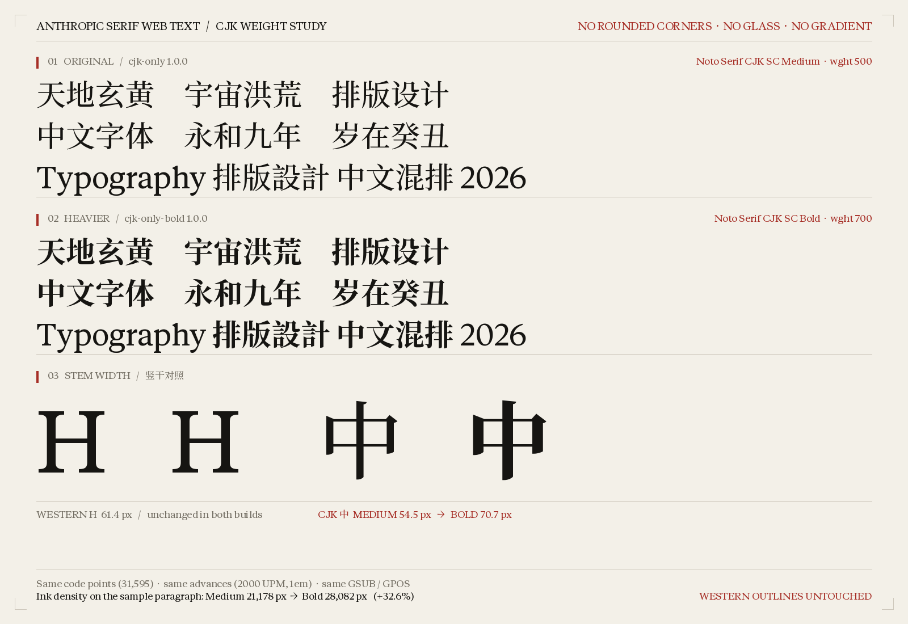
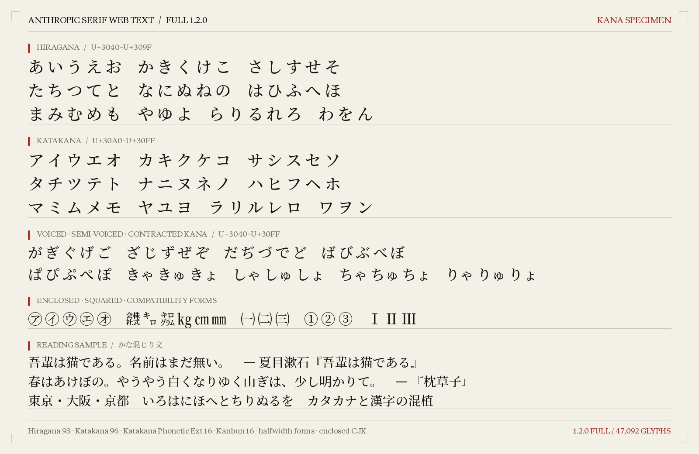
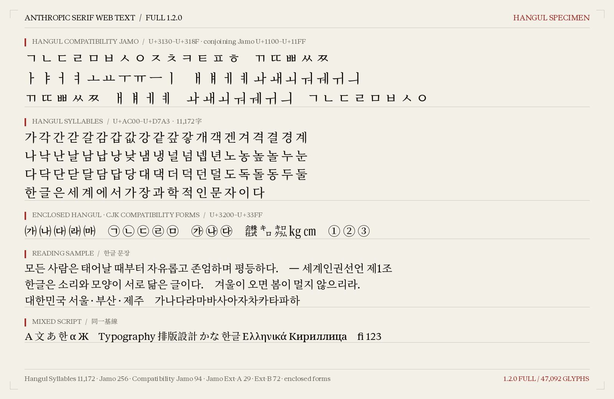
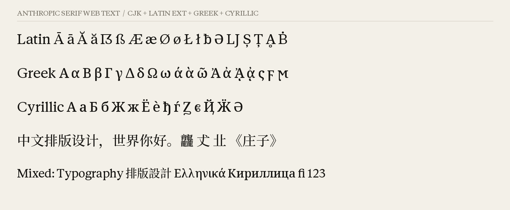
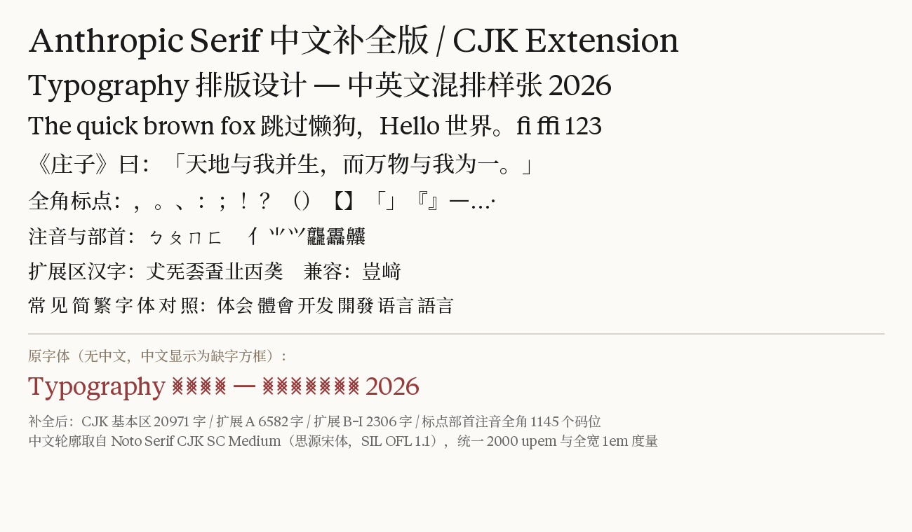

# Anthropic Serif CJK Extension

[](docs/CHARACTER-SET.md) [](docs/CHARACTER-SET.md) [](docs/BUILD.md) [](docs/CHARACTER-SET.md) [](OFL.txt) [](docs/COMPLIANCE.md) [](fonts/README.md)

给 **Anthropic Serif Web Text Regular** 补上一套完整的中日韩字符集，并进一步扩展到**拉丁扩展、希腊文、西里尔文**，同时公开可复现的构建过程、字符集明细与样张图。

原字体是一套用于阅读的西文衬线字体，只有 628 个码位、720 个字形，中文、假名、韩文、希腊文与西里尔文全部缺失。在中英混排时，中文会全部退化为缺字方框。本项目在**不改动任何西文字形、不改动原有 OpenType 排版特性、不改动原有字形编号顺序**的前提下追加字形，新增轮廓统一到 2000 UPM，中文与假名全宽 1em，「A」「文」「あ」「한」「α」「Ж」落在同一条基线上。

仓库提供**四个互不覆盖的独立版本**，各自带 TTF 与 WOFF2，也各自挂在 GitHub Release 上，不需要翻历史 commit 就能下载。其中一款专门解决「中文看起来偏细偏淡」：只把中文轮廓换成更粗的字重，西文、码位、度量一律不动。文档结构遵循 GitHub 官方 [About READMEs](https://docs.github.com/repos/managing-your-repositorys-settings-and-features/customizing-your-repository/about-readmes) 与 README 结构建议：先回答「这是什么、为什么有用、怎么开始」，深度内容放进 `docs/`。

---

## 授权与风险声明（请先阅读）

这一节不是免责套话，而是使用本仓库前必须确认的事实。

1. **上游拉丁字体是专有品牌字体。** `Anthropic Serif Web Text` 及相关名称属于 Anthropic, PBC，官方未提供公开的字体授权，也**不是** SIL OFL 字体。第三方资料同样将其描述为不公开许可的品牌字体（见 [docs/COMPLIANCE.md](docs/COMPLIANCE.md)）。四个版本的字体文件都包含该字体的全部西文轮廓，公开发布与再次分发可能需要权利人授权。
2. **本仓库按「公开仓库全量」发布。** 维护者确认已就公开分发所需权利自行作出判断并承担相应责任。若你打算在公司项目、商业产品或对外分发中使用，请先自行核实权利来源；本仓库不构成任何授权担保。
3. **新增轮廓部分受 SIL OFL 1.1 约束。** Noto Serif CJK SC 的版权归 Adobe 等权利人所有；Noto Serif（Latin-Greek-Cyrillic）的版权归 The Noto Project Authors。二者均依 [SIL Open Font License 1.1](OFL.txt) 授权。因此衍生部分必须同许可分发、随附版权声明与协议全文、不得单独售卖字体文件、不得使用原作者的名义为衍生版本背书、且保留名称条款需被尊重。完整说明见 [LICENSE](LICENSE) 与 [docs/COMPLIANCE.md](docs/COMPLIANCE.md)。
4. **字体内部名称仍含上游品牌名。** 为保持与原始字体在系统中可替换，四个版本的 `name` 表都沿用 `Anthropic Serif Web Text`，字重标识也统一为 Regular（加粗版只加重中文轮廓，不是合成粗体）。若你要以更保守的方式再分发，可按 [docs/BUILD.md](docs/BUILD.md) 中的改名步骤修改内部家族名。
5. **四个版本共用同一个内部家族名。** 因此**不要同时安装**，会与系统字体缓存冲突；按下面表格四选一即可。`cjk-only` 与 `cjk-only-bold` 的家族名和子族名完全相同，尤其不能并存。
6. **本项目与 Anthropic、Adobe、Google 均无 affiliation。** 仓库名与字体名仅用于描述被扩展的对象，不代表任何一方的赞助、背书或参与。

---

## 版本选择

| 版本 | 收了什么 | 字形 | 什么时候用 |
| --- | --- | --- | --- |
| [cjk-only 1.0.0](fonts/cjk-only/) | 只补中文，中文用 Medium 字重 | 31,724 | 只要中文、要最小体积 |
| [cjk-only-bold 1.0.0](fonts/cjk-only-bold/) | 与上一行**码位完全相同**，中文换成 Bold 字重 | 31,724 | 觉得中文偏细偏淡 |
| [multilingual 1.1.0](fonts/multilingual/) | 中文 + 拉丁扩展 / 希腊 / 西里尔 | 33,897 | 中英希俄混排、IPA、polytonic 希腊 |
| [full 1.2.0](fonts/full/) | 上面全部 + 假名 + 韩文 + CJK 符号 | 47,092 | 日文、韩文、带圈方块符号 |

体积与 Release：`cjk-only` 15.3 / 6.9 MB（`v1.0.0-cjk-only`），`cjk-only-bold` 15.3 / 7.2 MB（`v1.0.0-cjk-bold`），`multilingual` 15.6 / 7.0 MB（`v1.1.0-multilingual`），`full` 23.6 / 8.4 MB（`v1.2.0-full`），依次为 TTF / WOFF2。

**关于加粗版**：它和 `cjk-only` 的码位、字形数、西文轮廓、2000 UPM 度量、19 个 GSUB 与 2 个 GPOS 特性逐项相同，唯一区别是中文轮廓取自 Noto Serif CJK SC **Bold**（wght 700）而非 Medium（wght 500）。同一段文字实测墨色从 21,178 px 增到 28,082 px（+32.6%），中文「中」竖干从 54.5 px 增到 70.7 px，而西文 `H` 竖干 61.4 px 纹丝不动。它是「西文 Regular + 中文加重」的复合字体，`OS/2.usWeightClass` 与子族名仍是 Regular，不是合成粗体。

四个目录里的文件彼此独立，任一版本更新都不会改动另外三版。完整对照与字重实测数据见 [fonts/README.md](fonts/README.md)。

## 为什么有用

- **一处解决多文种混排缺字**：不必为一段中文、日文、韩文、希腊文或俄文单独指定回退字体，也不必在 CSS 里拼一长串 `font-family`。
- **西文质量不被稀释**：原字体的 `GSUB` 特性（连字 `fi`/`ffi`、小型大写、旧式数字、分数、序号、样式集等）与 `GPOS` 字距全部保留，因为新增字形只追加在字形表末尾，原有 glyph id 未变。
- **中文覆盖足够深**：不只是常用字，CJK 扩展 A、扩展 B 至 I、兼容表意文字、中文标点、注音符号、部首、全角与半角形式都在同一个文件里。
- **中文太细有独立解**：`cjk-only-bold` 只换中文轮廓字重，西文一个笔画都不动，也不用给整段文字套 `font-weight: bold` 或合成加粗，避免西文一起变糊。
- **假名与韩文成体系**：平假名、片假名、音标扩展、汉文标记、11,172 个韩文音节、Jamo 与兼容 Jamo、扩展 A/B 全都在；`full` 版一口气补齐思源宋体 SC 的剩余字符集。
- **希腊与西里尔覆盖到扩展区**：含希腊扩展（带气息与重音的 polytonic 希腊文）、西里尔扩展 A/B/C，以及组合变音符号，古籍与语言学文本也能排。
- **可直接上网页**：四版都提供 WOFF2，附带子集化建议，避免把整套字库压给访问者。
- **过程完全可复现**：构建脚本、依赖版本、轮廓转换参数、可变字体实例字重与度量处理全部公开；换 `--cjk-ttc` 指向不同字重的 TTC 即可改中文浓淡，`--no-lgc` 重建 1.0.0，默认参数重建 1.1.0，`--full` 重建 1.2.0。

## 核心特性（以 full 1.2.0 为准）

| 项目 | 数值 |
| --- | --- |
| 追加码位合计 | 46,372 |
| 总字形数 | 47,092 |
| cmap 可用码位 | 46,963（含非 BMP 字符 2,619 个） |
| 基本区 U+4E00–U+9FFF | 20,971 字 |
| 扩展 A / 扩展 B–I | 6,582 / 2,306 字 |
| 韩文音节 U+AC00–U+D7A3 | 11,172 字 |
| 平假名 / 片假名 / 音标扩展 / 汉文标记 | 93 / 96 / 16 / 16 |
| 韩文 Jamo 与兼容 Jamo（含 Ext-A/B） | 451 |
| 带圈、方块、制表与杂项符号（1.2.0 新增） | 1,351 |
| 拉丁扩展（含 IPA、音标、Ext-A 至 G） | 1,018 码位 |
| 希腊文（含 Greek Extended） | 354 码位 |
| 西里尔文（含 Ext-A/B/C） | 441 码位 |
| 单位度量 | 2000 UPM，中文与假名全宽 1em，韩文音节 1932，西文度量原样保留 |
| 轮廓转换 | CFF 转 TrueType（cu2qu，`max_err=0.5`）；可变 glyf 实例化后展开复合字形 |

`cjk-only` 1.0.0 只含中文相关行；`cjk-only-bold` 1.0.0 与它**码位、字形数完全相同**，仅中文轮廓字重不同，因此上表所有覆盖数字一致；`multilingual` 1.1.0 在 1.0.0 之上增加拉丁、希腊、西里尔。逐段 Unicode 明细见 [docs/CHARACTER-SET.md](docs/CHARACTER-SET.md)。

## 效果对比

同一段文字、同一字号、同一基线。上半为补全后，下半为原字体，中文显示为缺字方框。



**中文字重对照**（`cjk-only` 1.0.0 对 `cjk-only-bold` 1.0.0）：上半 Medium、下半 Bold，末节并列西文 `H` 与中文「中」的竖干。西文字形两版逐字节相同，中文墨色增加 32.6%。



**假名预览**（`full` 1.2.0）：五十音、浊音、拗音、带圈与方块符号、日文混排样句。



**韩文预览**（`full` 1.2.0）：兼容 Jamo、11,172 音节抽样、带圈韩文、韩文句段与六文混排。



多文种样张（拉丁扩展、希腊、西里尔、中文）：



完整的双语排版样张（含标点、注音、部首、扩展区生僻字与简繁对照），四版通用：



## 快速开始

先按「版本选择」挑一个，然后直接取用已构建好的字体文件，无需安装任何依赖。

```bash
git clone https://github.com/Moirania/Anthropic-Serif-CJK-Extension.git
cd Anthropic-Serif-CJK-Extension

ls fonts/cjk-only/         # 1.0.0 只要中文
ls fonts/cjk-only-bold/    # 1.0.0-bold 中文加粗版
ls fonts/multilingual/     # 1.1.0 中英希俄
ls fonts/full/             # 1.2.0 再加假名韩文
```

桌面使用：双击对应 TTF（Windows 选择「安装」；macOS 用「字体册」导入；Linux 复制到 `~/.local/share/fonts/` 后执行 `fc-cache -fv`）。安装后在应用里选择 `Anthropic Serif Web Text` 即可。记得只装一个版本——`cjk-only` 与 `cjk-only-bold` 的家族名和子族名完全相同，尤其不能并存。

网页使用，把 WOFF2 放到静态目录并声明 `@font-face`，这里以 `full` 为例：

```css
@font-face {
  font-family: "Anthropic Serif Web Text";
  src: url("/fonts/AnthropicSerifWebText-Full.woff2") format("woff2");
  font-weight: 400;
  font-style: normal;
  font-display: swap;
}

body {
  font-family: "Anthropic Serif Web Text", Georgia, serif;
  font-feature-settings: "liga" 1, "kern" 1;
}
```

打开 [docs/USAGE.md](docs/USAGE.md) 可看到日文、韩文与多语言排版示例、OpenType 特性清单、子集化命令与常见注意事项。

## 从源码构建

同一个脚本产出四个版本；完整步骤、依赖与参数说明见 [docs/BUILD.md](docs/BUILD.md)。

```bash
pip install fonttools brotli

# 1.0.0 cjk-only（跳过 LGC 来源）
python3 scripts/build_cjk.py \
  --latin /path/to/AnthropicSerifWebText.ttf \
  --cjk-ttc /path/to/NotoSerifCJK-Medium.ttc \
  --no-lgc --out ./fonts/cjk-only/AnthropicSerifWebText-CJK-Only.ttf

# 1.0.0-bold cjk-only-bold（同一覆盖，中文换成 Bold 轮廓）
python3 scripts/build_cjk.py \
  --latin /path/to/AnthropicSerifWebText.ttf \
  --cjk-ttc /path/to/NotoSerifCJK-Bold.ttc \
  --no-lgc --version-string "Version 1.000 CJK Bold" \
  --out ./fonts/cjk-only-bold/AnthropicSerifWebText-CJK-Only-Bold.ttf

# 1.1.0 multilingual（默认，双来源）
python3 scripts/build_cjk.py \
  --latin /path/to/AnthropicSerifWebText.ttf \
  --cjk-ttc /path/to/NotoSerifCJK-Medium.ttc \
  --lgc-font "/path/to/NotoSerif[wdth,wght].ttf" \
  --out ./fonts/multilingual/AnthropicSerifWebText-Multilingual.ttf

# 1.2.0 full（再补齐思源宋体 SC 剩余字符集：假名、韩文、CJK 符号）
python3 scripts/build_cjk.py \
  --latin /path/to/AnthropicSerifWebText.ttf \
  --cjk-ttc /path/to/NotoSerifCJK-Medium.ttc \
  --lgc-font "/path/to/NotoSerif[wdth,wght].ttf" \
  --full --out ./fonts/full/AnthropicSerifWebText-Full.ttf
```

`--full` 会取 CJK 来源里所有尚未覆盖的码位，但会跳过 LGC 来源**实际能提供**的字符，避免用稀疏的思源宋体希腊字形替换掉更完整的 Noto Serif 字形。

`--cjk-ttc` 指向哪个字重的 TTC，中文就有多浓，码位和度量不受影响。实测西文 `H` 竖干 61.4 px 时：Medium 中文「中」54.5 px、SemiBold 60.7 px、Bold 70.7 px、Heavy 82.3 px。想要「精确匹配」而非明显加粗，把加粗版命令里的 `Bold.ttc` 换成 `SemiBold.ttc` 即可；详见 [docs/BUILD.md](docs/BUILD.md)。

## 文档导航

| 文档 | 内容 |
| --- | --- |
| [fonts/README.md](fonts/README.md) | 四个独立版本的对照、选用建议与 Release 说明 |
| [docs/USAGE.md](docs/USAGE.md) | 安装、CSS、日文韩文示例、OpenType 特性、子集化、渲染注意事项 |
| [docs/BUILD.md](docs/BUILD.md) | 构建原理、四种预设、字重实测、校验方法与改名步骤 |
| [docs/CHARACTER-SET.md](docs/CHARACTER-SET.md) | 按 Unicode 分区的逐段覆盖明细 |
| [docs/COMPLIANCE.md](docs/COMPLIANCE.md) | 上游授权、OFL 义务、商标与再分发风险 |
| [FONTLOG.txt](FONTLOG.txt) | 逐项修改记录与版本历史（遵循 OFL 惯例） |
| [CONTRIBUTING.md](CONTRIBUTING.md) | 贡献方式 |
| [CODE_OF_CONDUCT.md](CODE_OF_CONDUCT.md) | 社区行为准则 |

## 项目结构

```
.
├── fonts/
│   ├── README.md        四版对照与选用建议
│   ├── cjk-only/        1.0.0：TTF + WOFF2，仅中文补全（Medium）
│   ├── cjk-only-bold/   1.0.0-bold：同覆盖，中文加粗（Bold）
│   ├── multilingual/    1.1.0：TTF + WOFF2，加拉丁/希腊/西里尔
│   └── full/            1.2.0：TTF + WOFF2，再加假名/韩文/CJK 符号
├── assets/              前后对比、字重对照、假名与韩文预览、多文种样张
├── scripts/             build_cjk.py，可复现构建脚本
├── docs/                使用、构建、字符集与合规文档
├── README.md            本文件
├── LICENSE              文档与脚本许可，以及字体文件的分层授权说明
├── OFL.txt              SIL Open Font License 1.1 全文
├── FONTLOG.txt          修改记录与版本历史
└── CITATION.cff         引用信息
```

## 获取帮助

- 使用与构建问题：先查 [docs/](docs/)，再到 [Issues](https://github.com/Moirania/Anthropic-Serif-CJK-Extension/issues) 提问。
- 缺字、字形错位、行高异常等具体缺陷：请附上**所用版本**、字符码位、操作系统、浏览器或渲染引擎版本，以及一张截图。
- 授权相关问题：请先阅读 [docs/COMPLIANCE.md](docs/COMPLIANCE.md)；本仓库无法代替权利人给出授权结论。

## 贡献与维护

欢迎提交缺字报告、字符集扩展、构建脚本改进与文档修正，流程见 [CONTRIBUTING.md](CONTRIBUTING.md)。仓库由 [Moirania](https://github.com/Moirania) 维护。请注意：由于上游字体的授权状态，涉及**新增或替换字形轮廓**的 PR 需要同时说明来源与许可，否则无法合并。若新增第五个版本，请放进 `fonts/` 下独立目录，不要覆盖现有四版。

## 许可证

- 仓库中的文档、脚本与样张图：见 [LICENSE](LICENSE)。
- 中文、假名、韩文、拉丁扩展、希腊与西里尔轮廓及其衍生部分：[SIL Open Font License 1.1](OFL.txt)，版权与条件详见 [LICENSE](LICENSE) 与 [FONTLOG.txt](FONTLOG.txt)。
- 上游西文轮廓：专有字体，权利归 Anthropic, PBC 所有，**不适用**上述任何开源许可。完整说明见 [docs/COMPLIANCE.md](docs/COMPLIANCE.md)。

## 致谢

- 西文原始字体：Anthropic Serif Web Text Regular。
- 中文、假名、韩文与 CJK 符号轮廓：Noto Serif CJK SC / 思源宋体，Adobe 与 Google 等贡献者，SIL OFL 1.1。
- 拉丁扩展、希腊、西里尔轮廓：Noto Serif（latin-greek-cyrillic），The Noto Project Authors，SIL OFL 1.1。
- 构建工具：fontTools（`cu2qu`、`varLib.instancer`、`ttLib`、`DecomposingRecordingPen`）。
